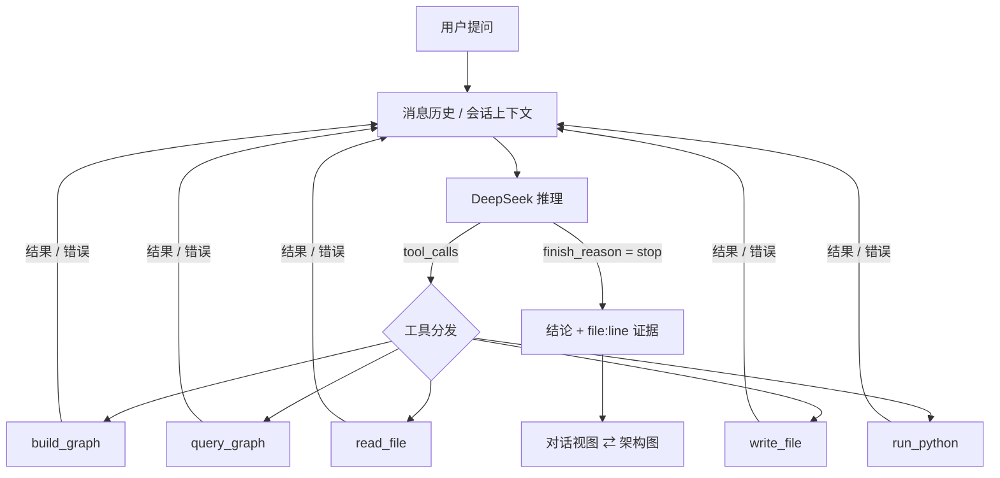
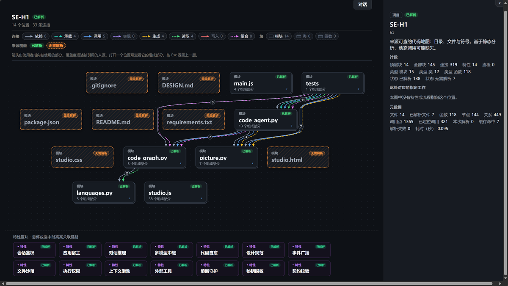
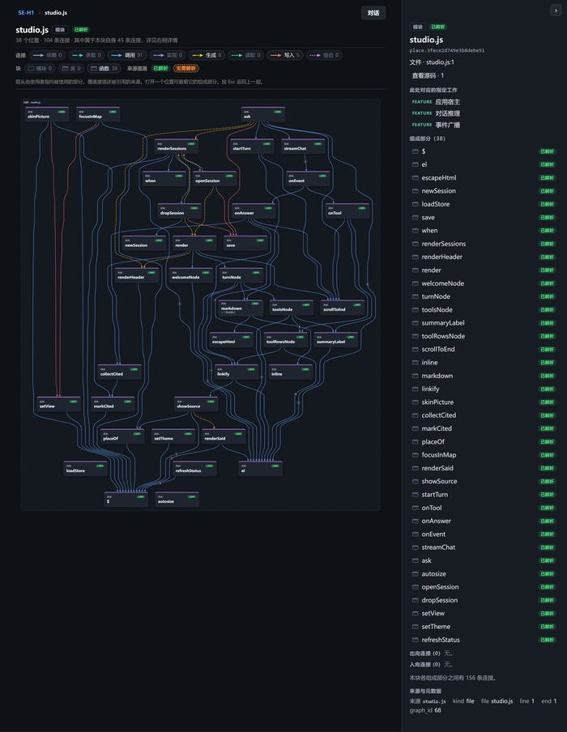
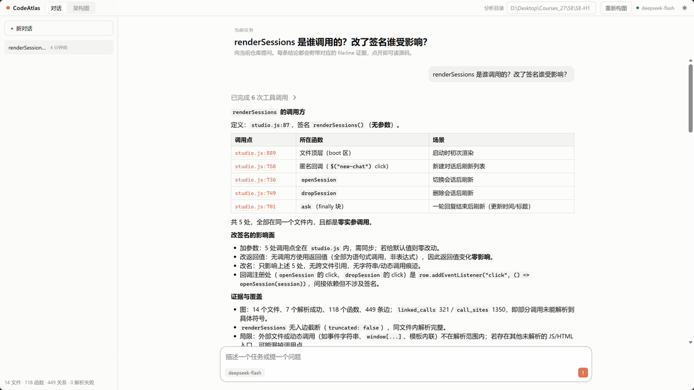
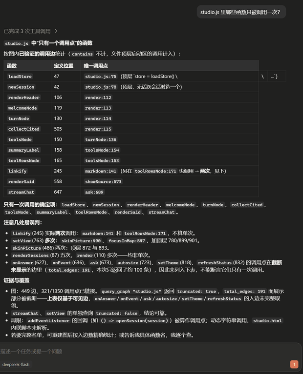
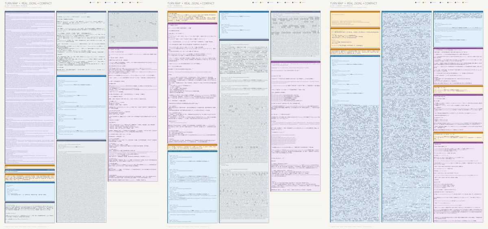

# CodeAtlas Studio

## 项目简介

CodeAtlas Studio 是《软件工程》Homework 1 开发的 **代码审查 / 代码解释 Agent**。它用 Tree-sitter 把一个代码仓库解析成「文件 → 符号 → 调用关系」的图谱，由 DeepSeek 驱动的 Agent 循环按需调用工具查询图谱、读取源码、执行代码，最后给出**每条都带 `file:line` 证据**的结论。

核心流程：**提问 → 推理 → 工具调用（构图 / 查询 / 读文件 / 执行）→ 观察结果写回上下文 → 继续推理或输出结论**。前端是一个中文 Web 工作台，「对话」回答"为什么这么说"，「架构图」回答"代码在哪"，两者可以互相跳转。设计细节见 [DESIGN.md](DESIGN.md)。

## 演示视频

[▶ 查看演示视频（31 秒）](docs/demo.mp4)

视频内容：根层架构图 → 点块下钻 → 切到对话提问 → 工具调用逐步上屏 → 点开结论里的源码证据 → 一键跳回架构图（被引用的块标为「结论涉及」）→ 切换主题。

## 核心功能

- **Agent 循环**：基于 DeepSeek（OpenAI 兼容 API）的原生 function calling，最多 8 步推理-行动循环；工具出错时把错误回流给模型，由模型自行修正后重试。
- **5 个工具**：`build_graph`、`query_graph`、`read_file`、`write_file`、`run_python`，覆盖构图、检索、读写文件和代码执行。
- **结论可追溯**：回答中的每个 `文件:行号` 都能点开，弹窗显示真实源码片段，并列出本次对话里提到这里的原文。
- **架构图下钻**：一次只画当前一层；指向层外的边收束成「层外」ghost 块，不会出现穿堂而过的长线。单击块下钻，`Esc` 返回上一层。
- **上下文记忆**：服务端按会话保存消息历史，支持多轮追问；会话列表存在浏览器本地，刷新后可继续。
- **无 key 可用**：没有 API Key 时自动降级为「离线 · 本地静态审查」，同样输出带源码证据的结论，界面明确标注当前模式。
- **多语言**：Python、JavaScript、TypeScript、Go、Rust、Java、C/C++、C#、Ruby、PHP、Kotlin、Swift、Scala。
- **任意仓库**：本地目录或 Git 地址（浅克隆）都能构图，界面内改路径后「重新构图」，不需要重启服务。

## Agent 架构



每一步的工具调用都以 NDJSON 事件流推给前端（`running` → `done` / `failed`），所以能看到 Agent 查了什么、查了几次、哪一步失败。代码入口：[Agent 循环](code_agent.py) · [图谱构建](code_graph.py) · [语言规则](languages.py) · [架构图适配层](picture.py) · [前端外壳](studio.js) · [架构图 viewer（TypeScript）](viewer/src/viewer.ts)。

| 模块 | 职责 |
| --- | --- |
| `code_agent.py` | Agent 循环、工具契约、会话表、HTTP 服务、事件流、离线审查 |
| `code_graph.py` | Tree-sitter 增量解析、符号与调用关系、缓存 |
| `languages.py` | 各语言的扩展名与语法节点规则 |
| `picture.py` | 把图谱投影成架构图模型（`architecture-map-model/2`） |
| `studio.*` | 中文工作台外壳：对话、会话、源码弹窗、主题 |
| `viewer/` | 架构图渲染器，TypeScript 实现，`strict` 模式 0 错误 |

## 快速开始

### 环境安装

Python 3.11+：

```powershell
python -m venv .venv
.\.venv\Scripts\Activate.ps1
pip install -r requirements.txt
```

### 离线运行（无需 API Key）

```powershell
python code_agent.py . --port 8768
```

浏览器会自动打开 `http://127.0.0.1:8768/`，右上角显示「离线 · 本地静态审查」。

### 真实 DeepSeek 调用

```powershell
$env:DEEPSEEK_API_KEY = "你的 Key"
$env:DEEPSEEK_MODEL   = "deepseek-flash"   # 可选，默认即此
python code_agent.py . --port 8768
```

分析其他仓库：把第一个参数换成目标路径或 Git 地址，或者在界面标题栏的「分析目录」里修改后点「重新构图」。

### 桌面版（可选）

```powershell
npm install
npm start
```

Electron 外壳会自动拉起 Python 服务并打开窗口。

## 界面展示



仓库根层：每个块是一个文件或目录，虚线块是「无需解析」的非代码文件（不是解析失败）。



点进 `studio.js`：38 个函数和它们之间的调用关系，指向层外的边收束成「层外」ghost 块。



问「`renderSessions` 是谁调用的」：结论列出 5 个调用点各自的 `file:line` 和场景。



追问「哪些函数只被调用一次」：Agent 主动报出 `truncated: true`，说明结果只覆盖可见边。



窄窗口下的紧凑布局。

## 工具

| 工具 | 作用 | 限制 |
| --- | --- | --- |
| `build_graph` | 用 Tree-sitter 建立文件、符号和关系图 | 增量解析，未变文件走缓存 |
| `query_graph` | 查询符号及其入边、出边 | 限制返回规模，超出时报告 `truncated` |
| `read_file` | 按行读取仓库内文件 | 单次最多 200 行，不能越出仓库 |
| `write_file` | 写入修改 | 只能写在仓库边界内 |
| `run_python` | 在子进程中执行 Python | 有超时，保留输出 |

## 错误处理与安全

- **工具错误回流**：异常被包装成 `Tool error: …` 作为工具结果返回模型，由模型决定修正还是换路；前端对应行标为 `failed`。
- **重试与超时**：模型请求 60 秒超时、自动重试 1 次；循环最多 8 步，超出时明确报错而不是静默截断。
- **并发控制**：最多同时保留 4 个会话、同时运行 4 个请求，多余的按最久未用淘汰。
- **静态资源白名单**：只发布 `studio.*` 和 `viewer/viewer.*`，其它路径一律 404，`.env`、`auth.json`、私钥不会被读到。
- **源码读取边界**：`/api/source` 只接受图谱中已知的文件，路径必须留在仓库内，越界和外部符号链接都拒绝。
- **Key 不外泄**：API Key 只从环境变量读取，不写进图谱，也不回传前端。

## 本地接口

| 方法 | 路径 | 作用 |
| --- | --- | --- |
| `POST` | `/api/chat` | `{ "session", "prompt" }`，返回 NDJSON 事件流 |
| `GET` | `/api/status` | 当前模式（`llm` / `local`）、模型名、仓库路径、图谱统计 |
| `GET` | `/api/graph` | 完整图谱 |
| `GET` | `/api/picture` | 架构图片段，用于重新构图后就地刷新 |
| `GET` | `/api/source?file=…&line=…` | 源码片段（最多 120 行） |
| `POST` | `/api/build` | `{ "repo" }`，重新分析本地目录或 Git 地址 |

事件流示例：

```
{"t":"session","session":"…"}
{"t":"tool","id":"call_1","phase":"Agent step 1","tool":"query_graph","state":"running","detail":"…"}
{"t":"tool","id":"call_1","phase":"Agent step 1","tool":"query_graph","state":"done","detail":"…"}
{"t":"answer","text":"…"}
{"t":"done","mode":"llm","steps":3,"tokens":412}
```

## 项目测试

测试不需要 API Key，也不需要网络：

```powershell
python -m pytest tests -q
```

覆盖：Agent 循环与假模型客户端、工具事件回调、NDJSON 对话流、会话复用与淘汰、离线审查的证据引用、源码读取的行数与仓库边界、静态资源白名单、架构图模型投影、viewer 只在 shadow root 内工作、界面全中文、页面不引用任何远程资源。

viewer 的类型检查：

```powershell
cd viewer
npm install
npm run check
```

## 已知边界

- 静态解析覆盖不了所有动态调用；无法唯一定位的调用会被省略并计入统计，图谱是静态近似。
- `run_python` 是有超时的本地子进程，不是系统级沙箱，分析不可信仓库时应放在隔离环境里。
- 离线模式不做语义理解，只从图结构推导结论。
- 深层级块很多时架构图会整体等比缩小，字也随之变小。

## 作业评分项对应

| 评分项 | 实现与证据入口 |
| --- | --- |
| 功能完整性 40% | [Agent 与工具](code_agent.py) · [图谱](code_graph.py) · [多语言](languages.py) · [演示视频](docs/demo.mp4) |
| Agent 架构 30% | [Agent 循环 `CodeAgent.run`](code_agent.py) · 上文架构图 · [DESIGN.md](DESIGN.md) |
| 代码质量 20% | [测试](tests/test_backend.py) · [TypeScript viewer](viewer/src/viewer.ts) · 上文「错误处理与安全」 |
| 文档 10% | [README](README.md) · [DESIGN.md](DESIGN.md) · [viewer 说明](viewer/README.md) |
